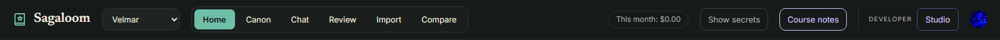
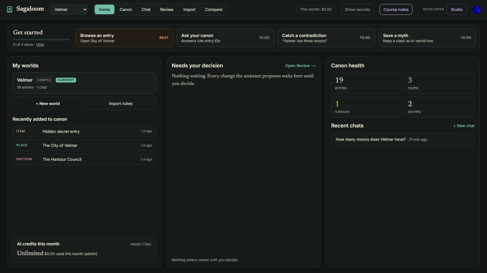
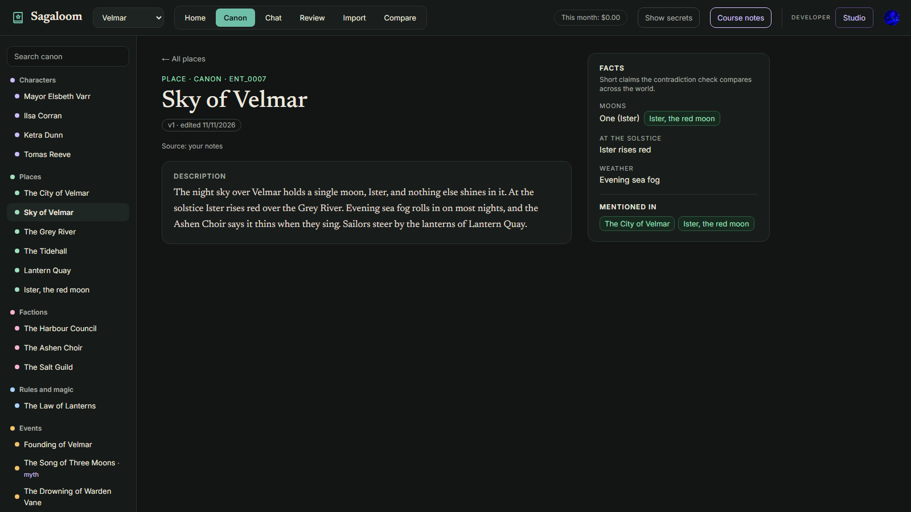
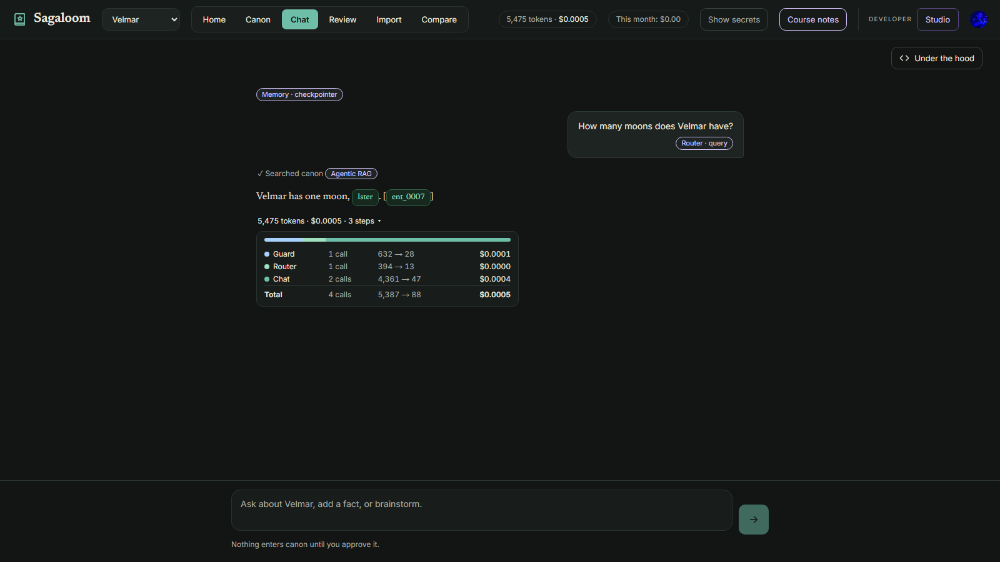
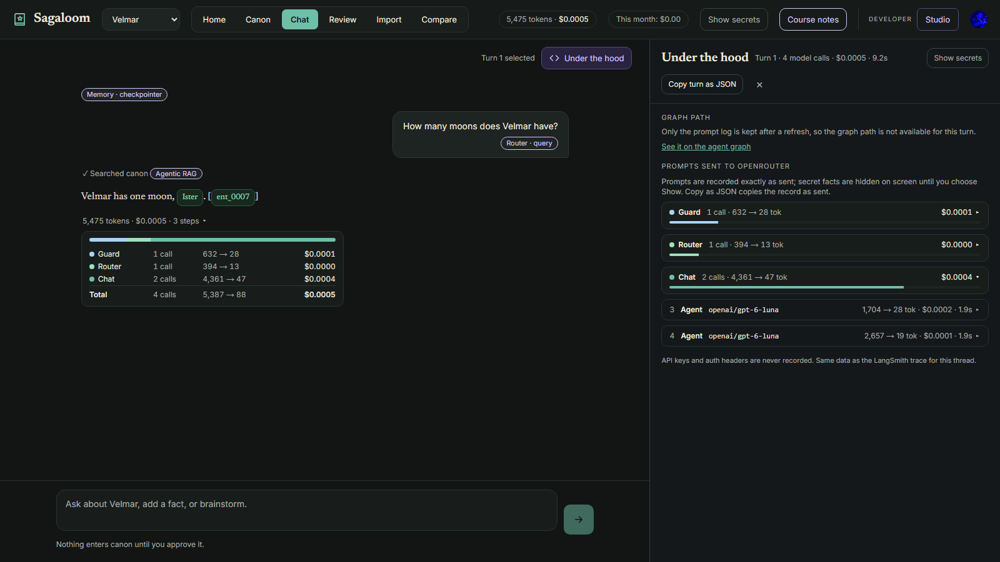
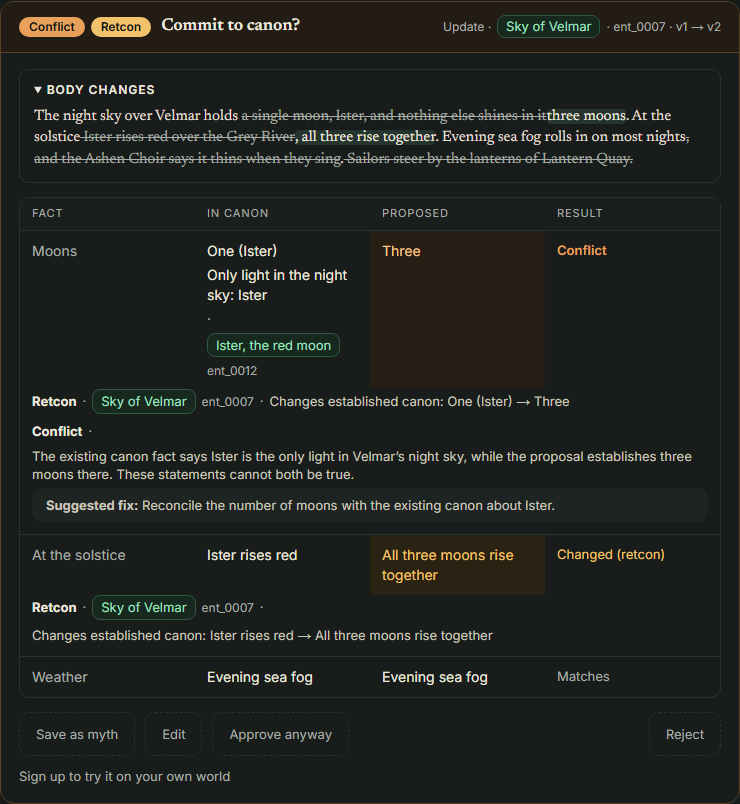
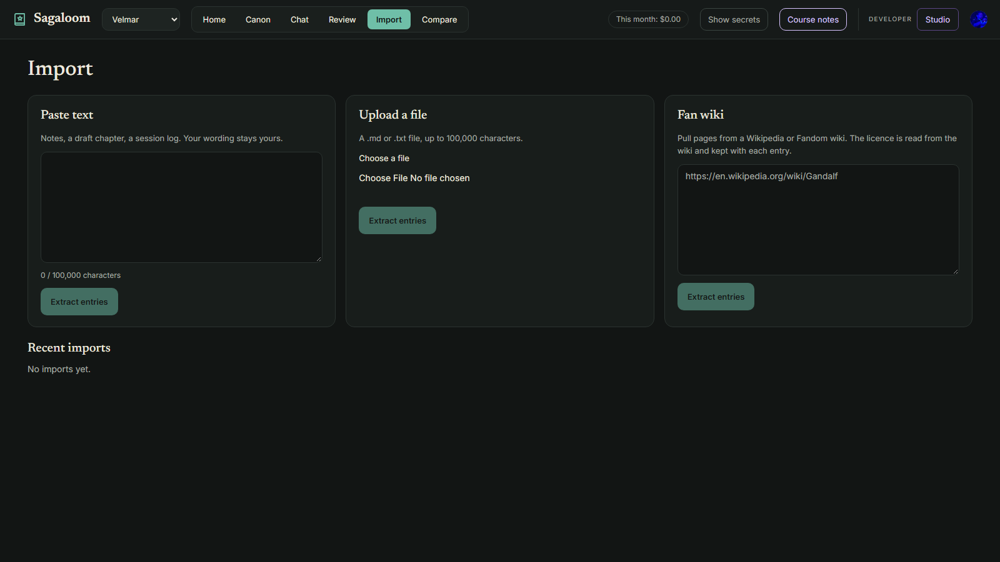
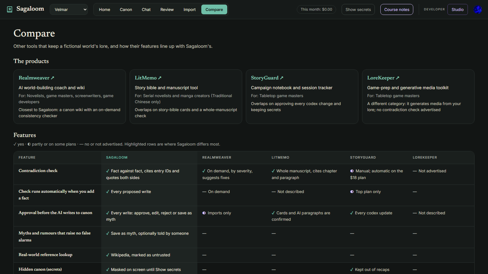
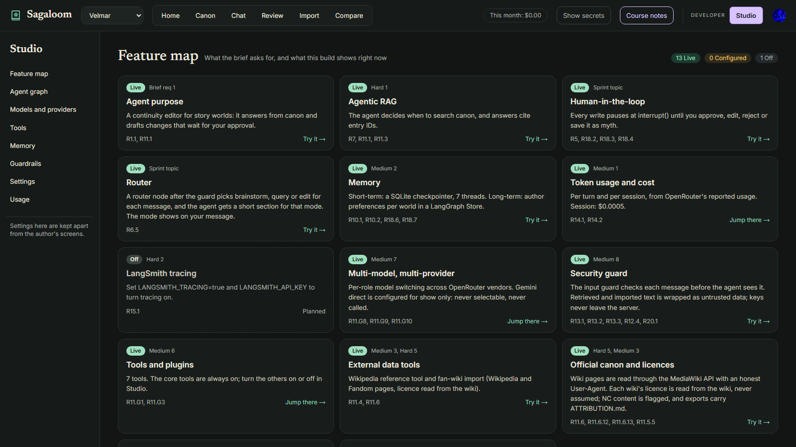
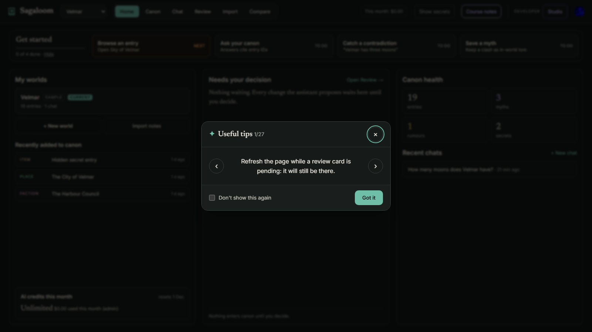

# Sagaloom user documentation

What you see on each screen, and what it means. Sections follow the screens in the order of the header tabs. Screenshots are of the sample world Velmar, taken on 12 November 2026. For setup and running the app, see the [README](../README.md).

- [Words used everywhere](#words-used-everywhere)
- [The header](#the-header)
- [Home](#home)
- [Canon](#canon)
- [Chat](#chat)
- [Review and the approval card](#review-and-the-approval-card)
- [Import](#import)
- [Compare](#compare)
- [Studio (Developer)](#studio-developer)
- [Course notes: the violet pills](#course-notes-the-violet-pills)
- [Startup tips](#startup-tips)

---

## Words used everywhere

**World.** One fictional setting with its own canon. Velmar is the sample world every account starts with (marked **SAMPLE**). You can make more worlds of your own.

**Entry.** One page of your world: a character, place, faction, item, event and so on. Each has an ID such as `ent_0007`, a description and a list of **facts**: short claims such as "Moons: One".

**Canon.** Everything you have approved into your world. Nothing enters canon until you approve it.

**Status.** Every entry *and every fact* has one of four statuses. They say whether something is true in the world, or only believed in it:

| Status | Meaning | Example | If it clashes with canon |
|---|---|---|---|
| **canon** | True in the world | "Velmar has one moon, Ister." | **Conflict**, a real continuity error |
| **myth** | A legend people in the world believe; probably false | "The Ashen Choir sings that Velmar once had three moons." | **Note** only |
| **rumour** | Unconfirmed talk in the world; may prove true or false | "They say the Choir drowned the old king." | **Note** only |
| **secret** | True, but hidden from characters or players | "The mayor is secretly a Choir member." | **Conflict**, like canon, because it is true |

Secrets are hidden on screen until you turn on **Show secrets**.

**Retcon** (retroactive continuity). Changing a fact already set in the *same* entry, for example Sky of Velmar's "Moons: One" to "Moons: Three". It may be deliberate, so it is not an error, but it is never silent either: you confirm it.

**Proposal.** A change the assistant suggests (new entry, update or delete). It waits in Review until you decide.

Source: the Glossary in [requirements.md](requirements.md#glossary-canon-statuses).

---

## The header

| You see | What it is |
|---|---|
| **Sagaloom** logo | Goes to Home |
| **World picker** (e.g. "Velmar") | The world you are working in. Every tab shows this world. **+ New world** at the bottom of the list creates one |
| **Home · Canon · Chat · Review · Import · Compare** | The main tabs. The current one is green |
| Red number on **Review** | Proposals waiting for your decision in this world. No number means nothing is waiting |
| **This month: $0.23 of $1.00** | Your AI spending this calendar month against your monthly budget. The admin has no limit and sees only the amount spent. It turns red when the budget is used up |
| **12,345 tokens · $0.0123** | Only on an open chat: what that conversation has cost so far |
| **Show secrets** | Shows secret entries and facts in this world while it is on. Off by default, and remembered only for this browser tab |
| **Course notes** | Shows or hides the violet course pills (see [Course notes](#course-notes-the-violet-pills)) |
| **Developer studio** | The developer page, set apart at the right in violet (see [Studio](#studio-developer)) |
| Round account picture | Your account: profile, sign out |

**When the monthly budget is used up**, the chat box is replaced by "You've used this month's AI budget ($1.00). It resets on 1 Dec." On approval cards, Approve, Edit and Save as myth are turned off; **Reject** still works, because it costs nothing. The budget resets on the first of each month (UTC).

---

## Home

The page you land on after signing in.

### Get started (the sample world only)

Four steps that show what Sagaloom does, in order: **Browse an entry**, **Ask your canon**, **Catch a contradiction**, **Save a myth**. Each card shows **DONE**, **NEXT** (the one to do now) or **TO DO**. Clicking a card takes you there; Chat cards fill in the question for you. **Hide** removes the strip for good. It does not appear on worlds of your own.

### My worlds

- Each world, with **SAMPLE** (the demo world) and **CURRENT** (the one selected) labels, and "19 entries · 5 chats · 2 waiting". Click a world to switch to it.
- **Chats** counts conversations you have written in. Empty chats are not counted.
- **Waiting** counts proposals across the world's chats and imports.
- **+ New world** and **Import notes**.
- **Recently added to canon**: the three newest entries. A secret entry shows as "Hidden secret entry" unless Show secrets is on.
- **AI credits this month**: how much of your budget is left, the amount used, a bar, and the reset day. The admin sees **Unlimited**.

### Needs your decision

Up to five conversations or imports with proposals waiting, each with its check badge (see [Badges](#badges-on-a-proposal)) and the number of proposals. The number in the heading is the total waiting. "Nothing waiting" means the queue is empty. **Open Review →** goes to the full list.

### Canon health

Counts for the current world: **entries**, **myths**, **rumours** and **secrets**. Each status counts the *entries* that have it or hold at least one fact with it, once each: "The Song of Three Moons" is a myth with two myth facts, and counts as **1 myth**. The count is the number of entries the tile's filtered list shows (secret ones only once you show secrets).

Click a tile to open Canon showing just what it counts: **myths** opens the myth entries and every entry that holds a myth fact (see [Filtering by status](#filtering-by-status)). **entries** opens the whole list.

### Recent chats

This world's four newest conversations, newest first, titled by your first message. Chats with no messages yet are left out. Imports are not chats and are not listed here. **+ New chat** opens an empty chat.

---

## Canon

The world bible: every approved entry of the current world.

- **Entries** list on the left, with **Search canon**, grouped by type (Characters, Places, Factions, Rules and magic, Events) with a coloured dot for each type. A myth or rumour entry says so beside its title. Each type heading shows how many entries it holds; click it to fold the group away (▶) and again to open it (▼). Typing in the search box opens every group, so no match is hidden.
- A **Non-commercial licence** label marks entries imported from a fan wiki whose licence forbids commercial use.
- **Show N secret entries** / **Hide secret entries** at the foot of the list, when the world has secrets.
- **Export** downloads the world as Markdown.

### Filtering by status

Opened from Home's Canon health tiles (or the address `/canon?status=myth`, `rumour` or `secret`):

- A **Showing myths** chip sits at the top of the list; **✕** clears it and shows every entry again.
- The list holds the entries that have that status, and entries with a *fact* of that status. For a fact, its name shows under the entry title, e.g. "Founding · myth".
- The filter stays on while you open entries from the list.
- **Secrets stay hidden** until you show them: under **secrets**, the list stays empty, with a **Show 2 secrets** button. A myth or rumour inside a secret entry is hidden the same way.
- Search still works inside the filtered list.

**An entry page** shows:

| You see | Meaning |
|---|---|
| Type · status · ID, title, and version | What the entry is, whether it is canon, myth, rumour or secret, its ID, and how many times it has been edited |
| **Source: your notes / official canon / Wikipedia reference** | Where the entry came from: you, an imported fan wiki, or a Wikipedia lookup |
| **Contains imported text** | Part of the description was copied word for word from an import |
| **Untrusted source** | The text came from outside (a web page); the assistant treats it as data, never as instructions |
| **Facts** | The short claims checked for clashes, each with its own status, and who tells it for a myth or rumour |
| **Mentioned in** | Other entries that mention this one |

---

## Chat

Ask about your world, state new facts, or brainstorm. The box says: "Ask about your world, add a fact, or brainstorm." Type `@` to get entry suggestions (the message stays plain text). Enter sends; Shift+Enter adds a line.

### Your message

**Router · query** (the pill under your message) is the mode the **router** picked for that message. The router is a small, cheap AI call that reads only your message, before the assistant answers, and picks one of three modes:

| Mode | When | Example | What the assistant is told |
|---|---|---|---|
| **query** | You ask what the world already says | "How many moons does Velmar have?" | Search canon and cite entry IDs. A question is not a change: propose nothing |
| **edit** | You state a fact, or ask to add, change or delete something | "Velmar has three moons now" | Search canon, then propose exactly the change you stated, and nothing else |
| **brainstorm** | You want new ideas | "Suggest a name for the second moon" | Offer a few options, label each as a suggestion, and propose no canon change unless you ask |

The mode is decided by what you want, not by grammar: "the harbour freezes every winter" is **edit**, even with no "add".

Why it is there:

- **It keeps the assistant to what you meant.** A question gets an answer, not a change to your canon; a brainstorm gets suggestions, not entries.
- **It shows a routing pattern for the course.** The design spec's reason: a visible mode is the simplest live example of a router in front of an agent ([M2 design §3.4](superpowers/specs/2026-11-05-0947-sagaloom-m2-design.md)).

What it does *not* do:

- **It steers, it does not fence.** All three modes go to the same assistant with the same tools; only a short instruction is added to its prompt (visible in Under the hood). A plain statement of lore still becomes a proposal in any mode.
- **It never blocks you.** If the router call fails, the assistant answers without a mode.
- **It is not the contradiction check.** That runs later, on every proposal, whatever the mode.

The mode is saved on your message, so the pill is still there after a reload. The router uses the same model as the input guard, and its cost appears as **Router** in the cost line. Where it is defined: `ROUTER_PROMPT` and `MODE_SECTIONS` in [api/sagaloom/router.py](../api/sagaloom/router.py); requirement R6.5 in [requirements.md](requirements.md); walkthrough 12 in the [README](../README.md).

### The assistant's answer

| You see | Meaning |
|---|---|
| **… Thinking** | The assistant is working |
| **✓ Searched canon** | It searched your world's entries before answering, rather than answering from memory |
| **✓ Drafted a proposal** | It wrote a change for you to approve |
| **✓ Checked facts · …** | The proposal was checked against canon; the text says what was found |
| **✓ Looking it up on Wikipedia** | It fetched a real-world reference |
| Green chip with a name, e.g. `Ister` | An entry named in the answer. Click to open it |
| Green chip with an ID, e.g. `ent_0007` | A **citation**: the entry the claim came from. Every factual claim must cite one |
| Message with a **Guardrail** pill | The input guard blocked your message, as harmful or as an attempt to change how the assistant works. A blocked message is removed from the conversation |
| **Remembered** chip with **Undo** | The assistant saved a preference you stated ("keep the tone grim"). Undo removes it |

A citation may show square brackets around it, like `[ent_0007]`: the model wrote the brackets and only the ID became a chip.

### The cost line

**5,475 tokens · $0.0005 · 3 steps ▸** sits under each answer:

- **Tokens**: the amount of text sent to and from the AI models in that turn, all calls together.
- **$**: what that turn cost.
- **Steps**: how many kinds of AI call the turn used. Click ▸ for a bar and one row per step, with its calls, tokens in → out, and cost:

| Step | What it is |
|---|---|
| **Guard** | The input guard checking your message is safe |
| **Router** | The router picking the mode |
| **Chat** | The assistant itself (it may call the model more than once: before and after searching) |
| **Check** | The contradiction judge checking a proposal against canon |
| **Extraction** | Pulling entries out of imported text |

A plain question is usually 3 steps: Guard, Router, Chat. Searching canon is not a step of its own: it costs no AI call.

### Under the hood

The **Under the hood** button opens a side panel for one turn (pick the turn in the list beside it). Its heading sums the turn up: "Turn 1 · 4 model calls · $0.0005 · 9.2s".

- **Graph path**: the steps the turn went through, with timings, e.g. guard → router → agent → tools → agent. It is shown only for a turn run since the page was loaded; after a refresh it says so and links to the agent graph in Studio.
- **Tool calls**: each tool the assistant called, with its input and result.
- **Prompts sent to OpenRouter**: every prompt, grouped by step: the messages, the tool definitions, the response, tokens, cost, model and provider. Calls that saw secret facts are hidden unless Show secrets is on. API keys are never recorded.
- **Copy turn as JSON** copies the whole record.

### Other things in Chat

- **Memory · checkpointer** pill at the top of a reopened chat: the conversation was saved and restored.
- **Input guard off (Studio)**: shown when the guard has been switched off in Studio settings.
- **Decide on the pending change first**: a proposal in this chat is waiting; decide it before sending more.

---

## Review and the approval card

**Review** lists every chat and import with proposals waiting in this world. Open one to see its proposals as cards. A card also appears in Chat, under the answer that drafted it.

### The card

*This card is the recorded example on the public home page, where the buttons are turned off ("Sign up to try it on your own world"). In the app they work.*

**Commit to canon?** heads each card, with the action (**New entry**, **Update** or **Delete**), the entry, and its badges. Below:

- **Facts to commit** (new entry) or a before → after view of the changes (update): added and removed text, and changed facts. Secret parts show as `••••••` until you click Show.
- For a delete: "This entry will be deleted from canon", with the entries that mention or link to it.
- Each flag the check found: the existing entry it clashes with (cited by ID), both facts or both quotes, an explanation, and often a suggested fix.

### Badges on a proposal

Worst first:

| Badge | Meaning |
|---|---|
| **Conflict** (red) | A hard clash with a canon or secret fact in another entry |
| **Check failed** | The check could not run. Nothing was confirmed safe |
| **Possible conflict** (red outline) | It may clash; the judge is not sure |
| **Retcon** | It changes a fact already set in this same entry |
| **Note** | Worth knowing, not an error: e.g. it disagrees only with a myth or rumour, or may duplicate another entry |
| **No conflicts found** | The check found nothing |

### Your decision

| Button | Effect |
|---|---|
| **Approve** | Writes the change into canon. It reads **Approve anyway** when the card has a conflict, retcon or failed check |
| **Edit** | Change the proposal's text or facts first, then approve |
| **Save as myth** | Keeps the clashing claim as in-world lore (a myth) instead of canon, so it no longer clashes. Offered when there is a conflict or retcon |
| **Reject** | Drops the proposal. The assistant is told, and nothing changes |

After a decision in chat, the assistant reads what you decided and replies. **Decision notes** in Review list past decisions for that conversation.

**Non-commercial licence** on an import's review: some pages are licensed for non-commercial use only; approving them means the world can't be used commercially.

---

## Import

Bring existing lore in. Three ways, each with an **Extract entries** button:

- **Paste text**: notes, a draft chapter, a session log. "Your wording stays yours": the imported text is copied word for word, never rewritten. Up to 100,000 characters.
- **Upload a file**: a `.md` or `.txt` file, up to 100,000 characters.
- **Fan wiki**: paste page links from a Wikipedia or Fandom wiki. The licence is read from the wiki and kept with each entry.
  - **What is read from each page:** its opening text (the lead) and its infobox facts. Some Fandom wikis, such as the Marvel Database, put the whole article inside one page template; for those, the template's short fields become the facts and its **Overview** (or the first section of its **History**) becomes the text, up to about 6,000 characters. Other wikis, such as the Game of Thrones Wiki, name their fact boxes without the word "Infobox" (`Character`, `House`, `Settlement`, `Organization`, `Government`, `Location`); those are read as infoboxes too, and set the entry type (a House becomes a faction, a Settlement a place).
  - **Not imported: the page has no article text** means the page has no opening text to read, for example a disambiguation page such as Marvel's "Asgard". A skipped page makes no AI call and costs nothing.

**Recent imports** lists your past imports and how far each has got.

Sagaloom pulls entries and facts out of the text (the **Extraction** step), checks each against canon, and sends them to **Review**. Nothing enters canon until you approve it there. An entry that already exists is **merged**: its description is kept and the new text is added under an "Imported from …" heading. **Injection-safe extraction**: imported text is treated as data, so instructions hidden in it are not obeyed.

---

## Compare

How Sagaloom compares with similar tools (Realmweaver, LitMemo, StoryGuard, LoreKeeper), with a card and link for each, and a feature table:

- **✓** yes
- **◐** partly, or only on some plans
- **—** no, or not advertised

Highlighted rows are where Sagaloom differs most. The competitors were checked on 4 November 2026; their products may have changed since.

---

## Studio (Developer)

For seeing how the app works inside. Controls only the admin can change say so. The menu on the left jumps to each section.

| Section | What it shows |
|---|---|
| **Feature map** | One card per course feature, with its status and a **Try it →** link (**Planned** when not built yet). The violet course pills link here |
| **Agent graph** | The assistant's graph as a diagram. The nodes the chosen chat's last run went through are highlighted, e.g. "Last run: guard → router → agent" |
| **Tools** | The tools the assistant can call, and which are on (admin changes them) |
| **Guardrails** | The input guard's recent verdicts for the world selected in the header. The admin can switch to **All users** (every user, every world) |
| **Memory** | Preferences the assistant has remembered, which you can delete |
| **Usage** | Your token and cost totals for the world selected in the header ("Showing House of Dragon only."), split by step. The Feature map's thread count and cost line follow the same world. Pick another world in the header to see its figures. The admin can switch to **All users** (every user, every world) |
| **Models and providers** | The model used for each role, pinned to its provider. Only the admin can switch models |
| **Settings** | Developer settings such as the input guard and the monthly budget, 0 to 1000 US$ per account per month. Only the admin can change them |

---

## Course notes: the violet pills

Violet outlined pills such as **Router · query**, **Agentic RAG** and **Memory · checkpointer** mark course concepts on the screen. Click one to open its card in Studio's Feature map. Turn them off with **Course notes** in the header. They do not change how the app works.

| Pill | Where | Course concept |
|---|---|---|
| **Router · query / edit / brainstorm** | Under your message | A router node picks a mode before the agent runs |
| **Agentic RAG** | Beside "Searched canon" | The agent decides when and what to retrieve from canon |
| **Memory · checkpointer** | Top of a reopened chat | The conversation is saved per thread and restored |
| **Memory · store** | Beside a remembered preference | Long-term memory across conversations |
| **Guardrail** | On a blocked message | The input guard |
| **Human-in-the-loop · interrupt()** | On an approval card | The run pauses until you decide |
| **Injection-safe extraction** | On an import's review | Imported text is data, never instructions |
| **Official canon · licence** | On a fan wiki import's review | Source and licence are recorded |

---

## Startup tips

A **Useful tips** window opens once per browser session after you sign in, showing tips in random order. Use **‹ ›** to move between them; the count beside the title shows which tip you are on.

 Tick **Don't show this again** to stop it for your account in this browser.
